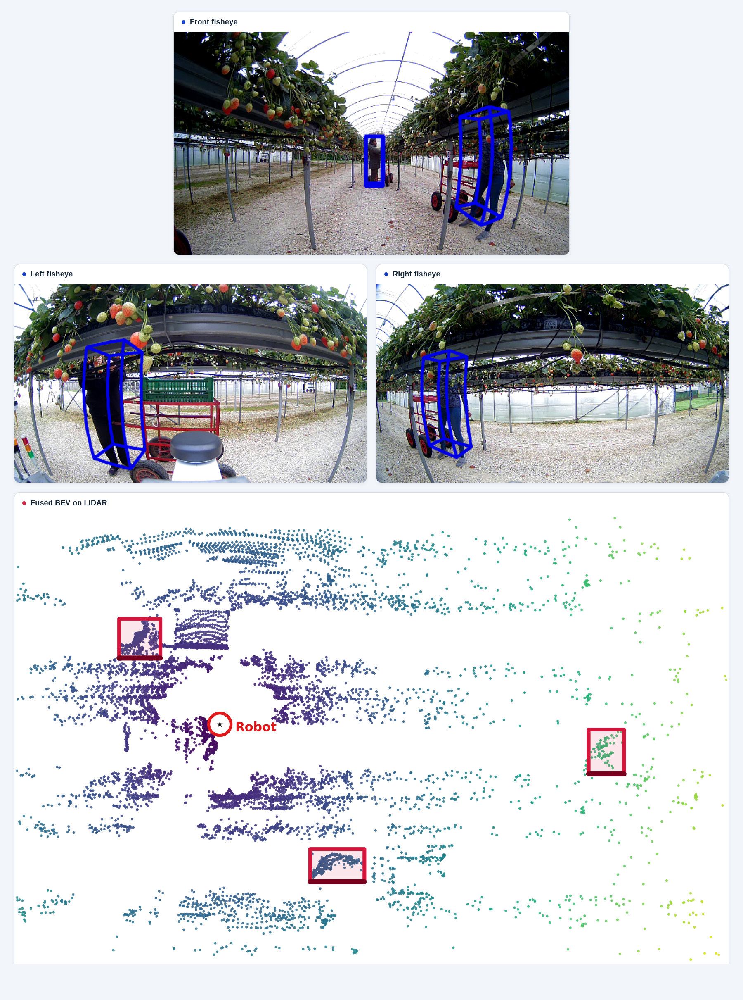

# AGHRI-BEVFusion

**AGHRI-BEVFusion** adapts [MIT-HAN-Lab BEVFusion](https://github.com/mit-han-lab/bevfusion) for 3D human detection on the **AGHRI** dataset.

AGHRI is a multimodal dataset for robot perception of humans in agricultural and off-road environments. It includes synchronized ZED RGB, fisheye camera, LiDAR, calibration, pose, and human-annotation data collected for close-proximity human–robot perception. This repository uses the **AGHRI-to-nuScenes-style representation** of the dataset to provide the data structure and PKLs required by the adapted BEVFusion pipeline.

<p align="center">
  
</p>

<p align="center">
  <em>Figure 1. Front, left, and right fisheye views with fused detections on the LiDAR bird’s-eye view.</em>
</p>

## Resources

- [Original AGHRI dataset](https://doi.org/10.24385/lincoln.32982638) and [submitted manuscript/preprint](https://papers.ssrn.com/sol3/papers.cfm?abstract_id=7360013)
- [AGHRI-nuScenes-tools](https://github.com/Prabuddhi-05/AGHRI-nuScenes-tools) — AGHRI-to-nuScenes-style conversion and PKL generation
- [AGHRI-nuScenes-release](https://github.com/Prabuddhi-05/AGHRI-nuScenes-release) — prepared AGHRI-to-nuScenes-style data and PKLs
- [Original BEVFusion](https://github.com/mit-han-lab/bevfusion) — upstream framework, installation guidance, and pretrained-model information

## What is Included

The upstream BEVFusion architecture remains the base of this repository. The AGHRI adaptation adds:

- an AGHRI dataset loader and one-class `human` evaluator;
- raw ZED RGB and fisheye image loading;
- camera-only, LiDAR-only, and camera–LiDAR fusion configurations;
- standard pinhole and distortion-aware LSS geometry;
- support for ZED `rational_polynomial` and fisheye `equidistant` camera models;
- compatible checkpoint transfer for pretrained and AGHRI-trained branches;
- AGHRI experiment configs under [`configs/aghri/`](configs/aghri/); and
- a portable experiment launcher at [`tools/run_aghri.py`](tools/run_aghri.py).

Detailed information is available in:

- [AGHRI adaptation](docs/AGHRI_ADAPTATION.md)
- [Experiment mapping](docs/EXPERIMENTS.md)
- [Training and evaluation](docs/TRAINING_AND_EVALUATION.md)

## Installation

Use a BEVFusion-compatible Python/CUDA environment with PyTorch, MMCV, MMDetection, MMDetection3D dependencies, TorchPack, OpenMPI/mpi4py, and the required CUDA extensions.

Follow the [upstream BEVFusion installation instructions](https://github.com/mit-han-lab/bevfusion#usage), then install this checkout in that environment:

```bash
python setup.py develop
```

The `weights/` folder contains five AGHRI checkpoints configured for Git LFS; see the [checkpoint manifest](weights/README.md).

## AGHRI Data Setup

Prepare the converted dataset using [AGHRI-nuScenes-tools](https://github.com/Prabuddhi-05/AGHRI-nuScenes-tools), or obtain the prepared [AGHRI-nuScenes-release](https://github.com/Prabuddhi-05/AGHRI-nuScenes-release).

The expected layout is:

```text
AGHRI-nuScenes-release/
├── dataset/
│   ├── samples/
│   ├── sweeps/
│   ├── v1.0-aghri/
│   └── metadata/
└── pkls/
    ├── full/
    │   └── pkls/
    ├── zed_lidar/
    │   └── pkls/
    └── fisheye_lidar/
        └── pkls/
```

Pass the dataset and PKL roots to the launcher:

```text
--dataset-root /path/to/AGHRI-nuScenes-release/dataset
--pkl-root /path/to/AGHRI-nuScenes-release/pkls
```

Fisheye camera and fusion experiments use `fisheye_lidar/pkls/`.

## Pretrained Weights

Pretrained binaries are not included in this repository. Place the upstream weights at:

```text
pretrained/
├── swint-nuimages-pretrained.pth  # nuImages-pretrained Swin camera backbone
└── lidar-only-det.pth             # nuScenes-pretrained LiDAR detector
```

For their original sources and usage terms, see [MIT-HAN-Lab BEVFusion](https://github.com/mit-han-lab/bevfusion).

The launcher also accepts `--camera-pretrained-checkpoint` and `--lidar-pretrained-checkpoint` to use checkpoints stored elsewhere.

### AGHRI Checkpoints

The `weights/` directory can hold the AGHRI-trained unimodal checkpoints used by D-F4 and selected complete fusion checkpoints:

```text
weights/
├── C2-DA_best_epoch_20.pth
├── L2_best_epoch_1.pth
├── F1_best_epoch_1.pth
├── F2_best_epoch_1.pth
└── D-F4_best_epoch_1.pth
```

- **C2-DA** — AGHRI-trained, nuImages-initialized camera-only model with distortion-aware LSS.
- **L2** — AGHRI-trained, nuScenes-initialized LiDAR-only model.
- **F1** — camera–LiDAR fusion with standard pinhole LSS.
- **F2** — camera–LiDAR fusion with distortion-aware LSS.
- **D-F4** — distortion-aware fusion initialized from the C2-DA and L2 checkpoints above.

See the [checkpoint manifest](weights/README.md) for each file and config. The five `.pth` files are configured for Git LFS; once published to GitHub, install Git LFS and run `git lfs pull` after cloning if they were not fetched automatically.

## AGHRI Test Results

These tables summarize held-out AGHRI test results. Bold marks the best value for each metric within its table.

### Camera-only

| Model | mAP ↑ | mATE ↓ | mASE ↓ | mAVE ↓ |
|---|---:|---:|---:|---:|
| C1-Pinhole | 0.5226 | 0.8529 | 0.3521 | 0.7138 |
| C1-DA | 0.6417 | 0.7352 | 0.3632 | **0.6388** |
| C2-Pinhole | 0.8714 | 0.4098 | **0.3358** | 0.6935 |
| C2-DA | **0.8731** | **0.3855** | 0.3398 | 0.7160 |

### LiDAR-only

| Model | mAP ↑ | mATE ↓ | mASE ↓ | mAVE ↓ |
|---|---:|---:|---:|---:|
| L1 | 0.9464 | 0.1513 | **0.3082** | 0.6508 |
| L2 | **0.9548** | **0.1092** | 0.3191 | **0.6382** |

### Selected fusion checkpoints

| Model | mAP ↑ | mATE ↓ | mASE ↓ | mAVE ↓ |
|---|---:|---:|---:|---:|
| F1 | 0.9450 | 0.1446 | 0.3155 | 0.6359 |
| F2 | 0.9510 | 0.1368 | 0.3282 | **0.6329** |
| D-F4 | **0.9575** | **0.1126** | **0.3117** | 0.6526 |

Experiment definitions and geometry settings are in [EXPERIMENTS.md](docs/EXPERIMENTS.md).

## Quick Start

Run commands from the repository root. Replace the example paths with your assembled AGHRI release.

Add `--dry-run` first if you want to inspect the selected config, PKLs, checkpoints, and underlying command without launching a job.

### Camera-only

`C2-DA` fine-tunes the nuImages-pretrained camera backbone on AGHRI using distortion-aware fisheye LSS:

```bash
python tools/run_aghri.py train --experiment C2-DA \
  --dataset-root /path/to/AGHRI-nuScenes-release/dataset \
  --pkl-root /path/to/AGHRI-nuScenes-release/pkls \
  --run-dir runs/C2-DA \
  --gpus 4
```

### LiDAR-only

`L2` fine-tunes the nuScenes-pretrained LiDAR model on AGHRI:

```bash
python tools/run_aghri.py train --experiment L2 \
  --dataset-root /path/to/AGHRI-nuScenes-release/dataset \
  --pkl-root /path/to/AGHRI-nuScenes-release/pkls \
  --run-dir runs/L2 \
  --gpus 4
```

### Distortion-aware Fusion

After training the required AGHRI camera and LiDAR branches, they can be combined for a D-F experiment.

For example, `D-F4` uses the AGHRI `C2-DA` camera checkpoint together with the AGHRI `L2` LiDAR checkpoint:

```bash
python tools/run_aghri.py train --experiment D-F4 \
  --camera-checkpoint weights/C2-DA_best_epoch_20.pth \
  --lidar-checkpoint weights/L2_best_epoch_1.pth \
  --dataset-root /path/to/AGHRI-nuScenes-release/dataset \
  --pkl-root /path/to/AGHRI-nuScenes-release/pkls \
  --run-dir runs/D-F4 \
  --gpus 4
```

The launcher builds the required branch initialization and then starts the normal AGHRI training entrypoint.

See [Experiments](docs/EXPERIMENTS.md) for C1/C2, L1/L2, F1/F2, and D-F1–D-F4.

## Evaluation

Choose the validation or test split explicitly:

```bash
python tools/run_aghri.py eval --experiment D-F4 \
  --checkpoint weights/D-F4_best_epoch_1.pth \
  --split test \
  --dataset-root /path/to/AGHRI-nuScenes-release/dataset \
  --pkl-root /path/to/AGHRI-nuScenes-release/pkls \
  --gpus 1
```

The AGHRI evaluator reports:

- AGHRI mAP;
- translation error;
- scale error; and
- velocity error as a secondary diagnostic.

See the [training and evaluation guide](docs/TRAINING_AND_EVALUATION.md) for metric details and the underlying TorchPack commands.

## Visualization

The [AGHRI visualizer](tools/visualize_aghri.py) supports ground-truth and prediction visualization using the AGHRI fisheye data and LiDAR BEV view.

Example prediction visualization:

```bash
torchpack dist-run -np 1 python tools/visualize_aghri.py \
  configs/aghri/fusion/fusion_distortion_aware_df.yaml \
  --mode pred \
  --checkpoint weights/D-F4_best_epoch_1.pth \
  --split test \
  --dataset-root /path/to/AGHRI-nuScenes-release/dataset \
  --ann-file /path/to/AGHRI-nuScenes-release/pkls/fisheye_lidar/pkls/aghri_fisheye_lidar_infos_test.pkl \
  --out-dir output/aghri_D-F4_test \
  --max-samples 10
```

## Documentation

For more detail, see:

- [`docs/AGHRI_ADAPTATION.md`](docs/AGHRI_ADAPTATION.md) — AGHRI dataset integration, camera geometry, modality-specific changes, and evaluation
- [`docs/EXPERIMENTS.md`](docs/EXPERIMENTS.md) — C1/C2, L1/L2, F1/F2, and D-F1–D-F4 experiment definitions
- [`docs/TRAINING_AND_EVALUATION.md`](docs/TRAINING_AND_EVALUATION.md) — training, evaluation, checkpoint initialization, launcher usage, and underlying TorchPack commands

## Attribution and Citation

This repository is based on [MIT-HAN-Lab BEVFusion](https://github.com/mit-han-lab/bevfusion). The upstream Apache-2.0 [LICENSE](LICENSE) and source attribution are preserved.

This adaptation is designed for:

**AGHRI: A dataset for multimodal robot perception of humans in agricultural and off-road environments**

- **Original dataset:** [University of Lincoln Research Repository](https://doi.org/10.24385/lincoln.32982638)
- **Submitted manuscript / preprint:** [SSRN](https://papers.ssrn.com/sol3/papers.cfm?abstract_id=7360013)

Please cite the original AGHRI dataset and associated manuscript where appropriate.
